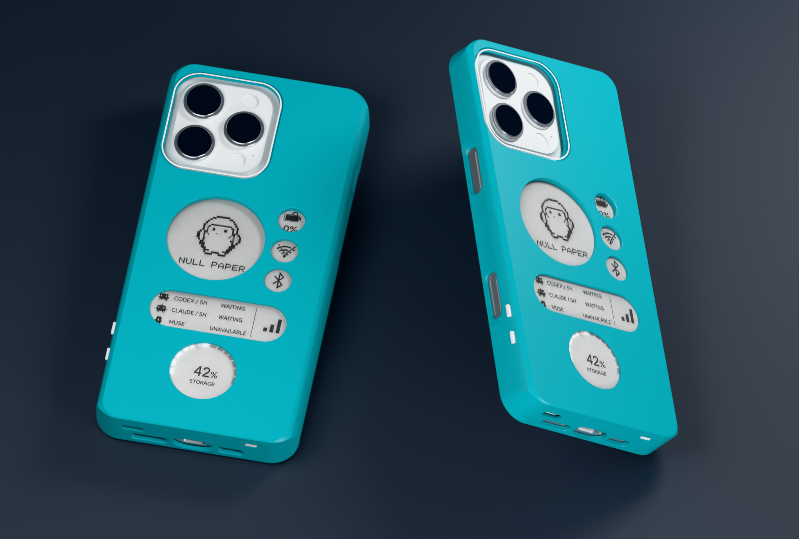
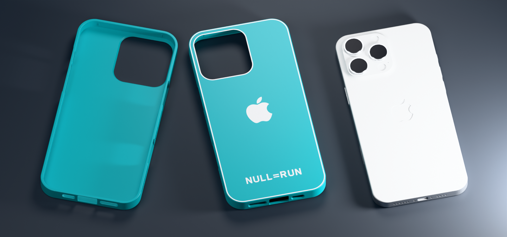
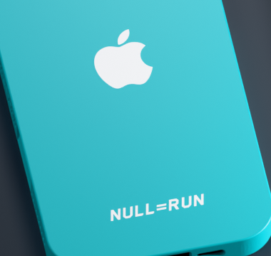

# null-iPhone-case

> [!WARNING]
> **v0.02beta でもケースが外れます。** 抜け止めリップを追加した試作品を実機に装着して確認したところ、ケースが外れました。この版のケースデータの印刷・使用は推奨しません。[v0.02beta プレリリース](https://github.com/GOROman/null-iPhone-case/releases/tag/v0.02beta)
>
> [旧版 v0.01beta](https://github.com/GOROman/null-iPhone-case/releases/tag/v0.01beta) にも同じ問題があります。

iPhone 16 Pro Max 向けケースのプロジェクトです。ケースの SolidCraft CAD データと、NULL CITY のロゴをもとにしたディスプレイ書体 **NULL FONT** を収録しています。

## PaperDIY 内蔵ケース v0.40

電子ペーパーを背面に組み込んだケースです。v0.40 はテストプリント中です。背面を下にして、0.4 mm ノズル・積層 0.20 mm・サポートなしでスライスしました。

[SolidCraft CAD](iPhone16ProMax/null-iPhone16ProMax-PaperDIY.sc) · [Bambu Lab H3C 用の印刷データ（3MF）](iPhone16ProMax/paperdiy/PaperDIY-H3C-bed-aligned.3mf)

## iPhone 16 Pro Max ケース

ケースのモデリングには **SolidCraft** を使用し、掲載画像は **Blender** でレンダリングしました。

### 低リム版 v0.30

- [SolidCraft CAD](iPhone16ProMax/null-iPhone16ProMax.sc)
- [ケース本体のSTL（単色）](iPhone16ProMax/null-iPhone16ProMax-case.stl)
- [H3C用3MF（シアン＋白、サポート付き）](iPhone16ProMax/low-rim/null-iPhone16ProMax-lowRim-H3C-cyan-white.3mf)

ケース上端と全周リップを0.70 mm下げた版です。Bambu Lab H3Cでシアンと白の2色造形に成功しました。[v0.30のダウンロード](https://github.com/GOROman/null-iPhone-case/releases/tag/v0.30)

## MuJoCoでの抜け止め検証

抜け止めリップを追加した更新版（コミット `3ef35e4`）で、ケースを固定し、iPhoneを装着位置から画面側へまっすぐ引いたときの接触を調べました。iPhone側面のCAD形状と3か所のリップを剛体として扱い、引き抜き量を0.005 mm刻みで変えています。

| 装着時の位置 | リップに当たり始めるまでの引き抜き量 |
| --- | --- |
| 中央 | 約0.68 mmで3か所すべてに接触 |
| 左右どちらかに0.10 mmずれた位置 | 約0.56 mmで近い側、約0.83 mmで反対側に接触 |

この検証では、画面側へまっすぐ引いた場合のリップの接触を確認しました。PLAのたわみや斜めに外す動きはモデル化していません。造形後の実機テストでは、装着してもケースが外れました。

## NULL FONT

Regular と Italic の2書体で、英字・数字・記号を収録しています。デスクトップ用の TTF・OTF と Web 用の WOFF2 が利用できます。

- [フォント一式をダウンロード（ZIP）](null-font/NULL-FONT.zip)
- [インストール方法・Web での使い方・再生成手順](null-font/README.md)
- [フォントのライセンス（SIL Open Font License 1.1）](null-font/OFL.txt)
