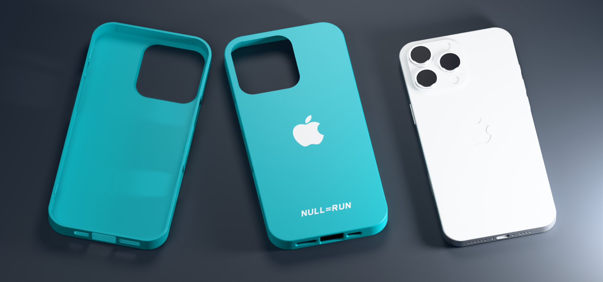
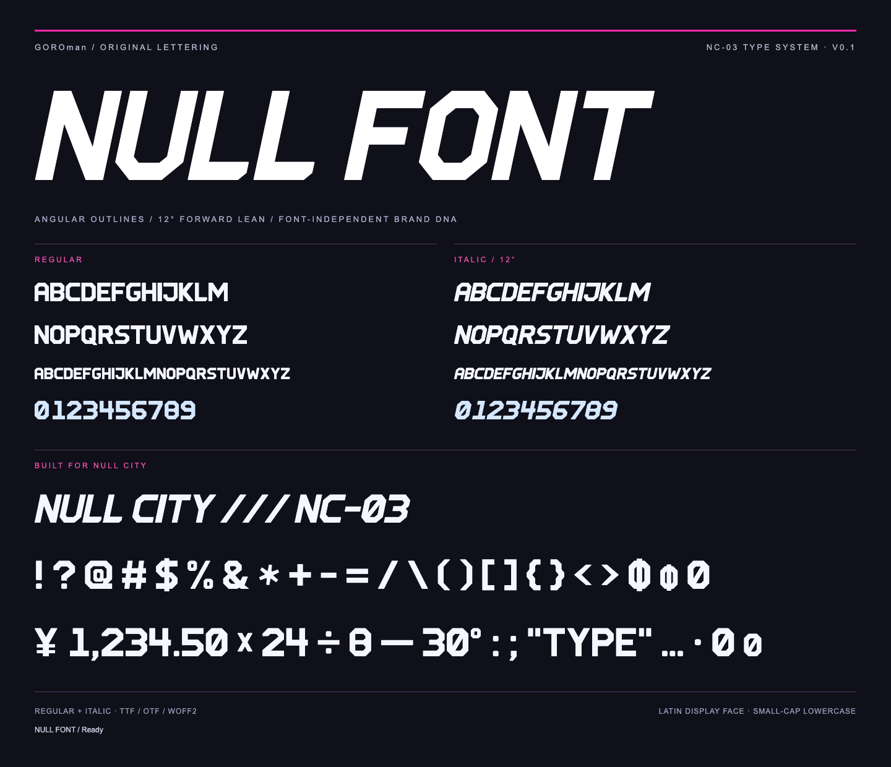

# null-iPhone-case

> [!WARNING]
> **v0.01beta には欠陥があります。** iPhone 16 Pro Max に装着しても保持力が足りず、通常の取り扱いでケースが外れます。この版のケースデータの印刷・使用は推奨しません。[プレリリースの詳細](https://github.com/GOROman/null-iPhone-case/releases/tag/v0.01beta)

iPhone 16 Pro Max 向けケースのプロジェクトです。ケースの SolidCraft CAD データと、NULL CITY のロゴをもとにしたディスプレイ書体 **NULL FONT** を収録しています。

## iPhone 16 Pro Max ケース

ケースのモデリングには **SolidCraft** を使用し、掲載画像は **Blender** でレンダリングしました。

## MuJoCoでの抜け止め検証

抜け止めリップを追加した更新版（コミット `3ef35e4`）で、ケースを固定し、iPhoneを装着位置から画面側へまっすぐ引いたときの接触を調べました。iPhone側面のCAD形状と3か所のリップを剛体として扱い、引き抜き量を0.005 mm刻みで変えています。

| 装着時の位置 | リップに当たり始めるまでの引き抜き量 |
| --- | --- |
| 中央 | 約0.68 mmで3か所すべてに接触 |
| 左右どちらかに0.10 mmずれた位置 | 約0.56 mmで近い側、約0.83 mmで反対側に接触 |

この検証で確認したのは、画面側へまっすぐ抜ける動きに対するリップの接触です。PLAのたわみや斜めに外す動きはモデル化していないため、実機での保持力と着脱のしやすさは未確認です。

## NULL FONT

Regular と Italic の2書体で、英字・数字・記号を収録しています。デスクトップ用の TTF・OTF と Web 用の WOFF2 が利用できます。

- [フォント一式をダウンロード（ZIP）](null-font/NULL-FONT.zip)
- [インストール方法・Web での使い方・再生成手順](null-font/README.md)
- [フォントのライセンス（SIL Open Font License 1.1）](null-font/OFL.txt)
