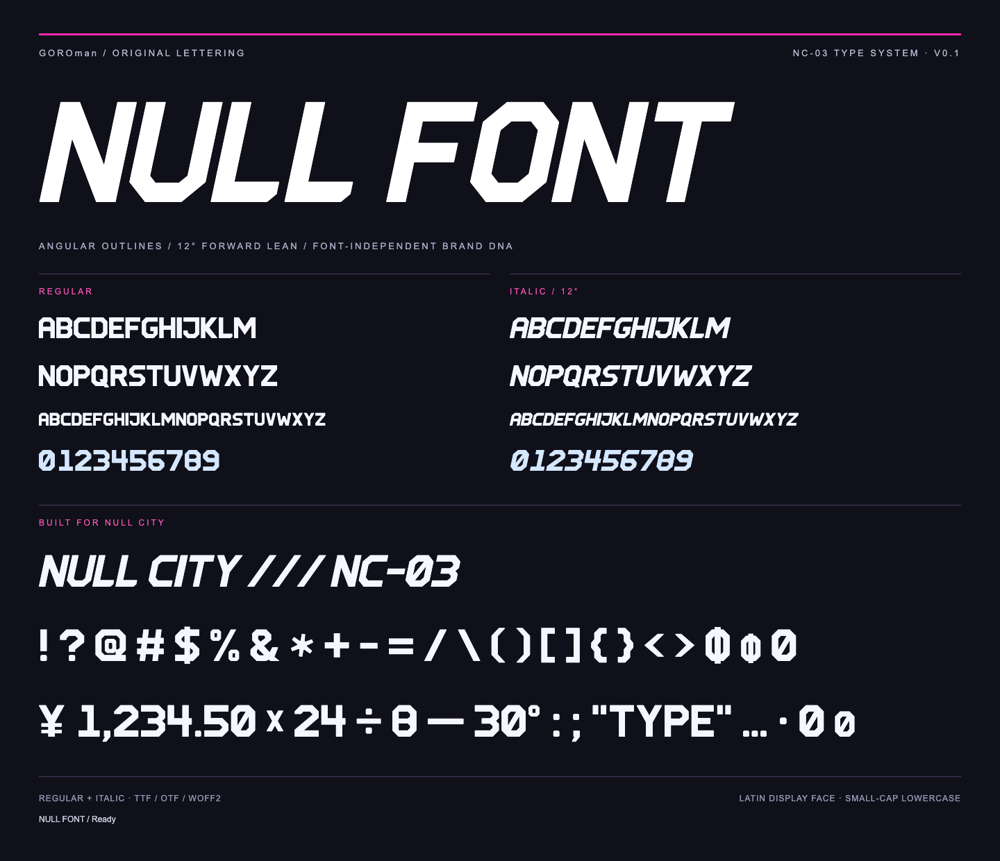

# NULL FONT

NULL CITYの専用ロゴから展開した、角形のディスプレイ書体。**Regular**と**Italic（右斜体12°）**の2書体。既存のN・U・L・C・I・T・Yの字形を維持し、英字・数字・記号へ展開した。



## ダウンロード

[まとめてダウンロード：NULL-FONT.zip](NULL-FONT.zip)

| 用途 | Regular | Italic |
|---|---|---|
| macOS・デスクトップ用TTF | [NULLFont-Regular.ttf](NULLFont-Regular.ttf) | [NULLFont-Italic.ttf](NULLFont-Italic.ttf) |
| デスクトップ用OTF | [NULLFont-Regular.otf](NULLFont-Regular.otf) | [NULLFont-Italic.otf](NULLFont-Italic.otf) |
| Web用WOFF2 | [NULLFont-Regular.woff2](NULLFont-Regular.woff2) | [NULLFont-Italic.woff2](NULLFont-Italic.woff2) |

[ブラウザー文字見本](specimen.html) ／ [PDF文字見本](specimen.pdf)

## 収録文字と用途

- ASCIIの印字可能文字95個：A–Z、a–z、0–9、スペース、基本記号。
- 小文字は高さ80%のスモールキャップ。数字は等幅で、0は斜線入り。
- 追加18記号：`° ¥ × − – — ÷ … • ‘ ’ “ ” Φ φ ⌀ Ø ø`。改行しないスペース（NBSP）にも対応。
- 各フォント114グリフ。日本語の字形は含まない。見出し、ロゴ、数字表示、デカール向け。

macOSではTTFかOTFのどちらか一方の形式で、RegularとItalicを開きFont Bookへ登録する。アプリを再起動し、フォント一覧で **NULL FONT** を選ぶ。同じ書体のTTFとOTFを重複登録する必要はない。

## Webで使う

`null-font.css` と2個のWOFF2を同じ場所に配置する。

```html
<link rel="stylesheet" href="null-font.css">
<style>
  .logo {
    font-family: 'NULL FONT', sans-serif;
    font-weight: 400;
    font-style: italic;
  }
</style>
<div class="logo">NULL CITY</div>
```

字間はフォント内で調整済み。ロゴに合わせる場合は追加の `letter-spacing` を0にする。大文字の高さはフォントサイズの70%なので、CSSの行ボックスには上下の余白がある。

## ソースと再生成

第三者フォントのアウトラインは使用していない。`build.py` が字形・メトリクス・カーニングを定義し、`brand-glyphs.json` が元のロゴ字形を保持する。`glyphs.json` は全字形の書き出しデータで、再生成時に上書きされる。

このディレクトリで実行する。

```sh
python3 -m venv .venv
.venv/bin/pip install -r requirements.txt
.venv/bin/python build.py
.venv/bin/python validate.py
```

FontTools 4.68.0で生成。macOS CoreTextでTTF／OTFの読み込みと収録文字を確認し、ChromeでWOFF2の表示を確認した。文字見本は生成したフォントを実際に読み込んだもの。Windows・Adobe製品・印刷業者の設備では未検証。

## ライセンス

Copyright © 2026 GOROman。このディレクトリ一式（TTF・OTF・WOFF2、字形ソース、生成・検証スクリプト、文字見本）は [SIL Open Font License 1.1](OFL.txt)。Reserved Font Nameの指定はない。

商用作品への利用、埋め込み、改変、再配布が可能。フォント単体の販売は禁止。再配布時には著作権表示とOFLを同梱し、改変したフォントにもOFLを維持する。フォントで作ったロゴ・印刷物にOFLを適用する必要はない。

`build.py` は6形式と `NULL-FONT.zip` を再生成する。ZIPにはこの説明・OFL・字形ソース・文字見本も入り、`validate.py` は同梱内容とリポジトリのファイルが一致することを検証する。文字見本の画像・PDF自体は、字形変更時にブラウザーから別途書き出す。
